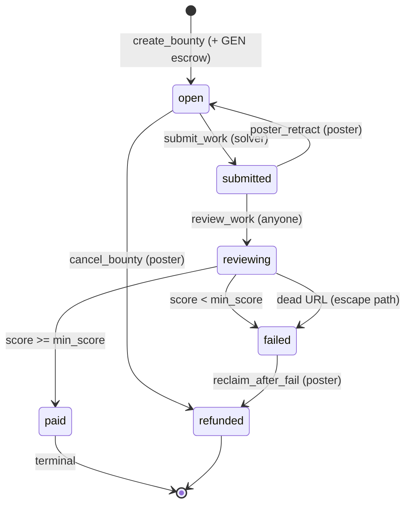

# GenTrophy

**Work that pays. Judged by AI consensus.**

A trustless, AI-judged bounty platform on [GenLayer](https://genlayer.com).
A poster locks GEN in an intelligent contract, a solver submits a URL with the
work, and validator nodes score that work with LLMs against the bounty's
rubric. If the consensus score meets the threshold, the escrow pays out
automatically — no moderator, no multisig, no trust.

- **Contract:** `GenTrophy` — Python intelligent contract on GenVM
- **Network:** GenLayer Studionet (chainId `61999`, gasless execution)
- **Deployed at:** `0x2C02539A051F62007254abFdFcF0982f0Fa4e7Ec`
- **Frontend:** Vite + React 19 + TypeScript + Tailwind CSS + `genlayer-js`

## How it works



1. **Post** — `create_bounty` sends GEN with the transaction; the contract
   escrows it and lists the bounty as `open`.
2. **Solve** — any wallet except the poster calls `submit_work` with an
   `http(s)` URL → `submitted`.
3. **Review** — anyone calls `review_work`. The leader node fetches the URL
   and scores it with an LLM; validators independently re-run the same
   evaluation and vote. Consensus requires both sides on the same side of the
   threshold and scores within **±10 points**.
4. **Settle**
   - `score >= min_score` → **`paid`**: reward transferred to the solver
     (terminal state).
   - `score < min_score` → **`failed`**: poster can `reclaim_after_fail`.
   - URL unreachable (consensus on `[EXTERNAL]`) → **`failed`**, score 0 —
     a dead link can never pay, even with `min_score = 0`.
5. **Escape hatches** — poster can `cancel_bounty` while `open`, or
   `poster_retract` a `submitted` bounty back to `open` (wipes the
   submission, escrow intact).

## Features

- **Escrow conservation** — every GEN is exactly one of: locked in escrow,
  paid to a solver (`total_paid_wei`), or refunded to the poster.
- **AI consensus judging** — leader/validator LLM evaluation with score
  tolerance, threshold agreement, and independent re-execution.
- **Dead-source escape path** — unreachable work URLs settle as `failed`
  instead of stranding escrow in `submitted`.
- **Post-consensus validation** — consensus results are type/range-checked
  before any state write (dict, integer score 0–100, feedback truncated).
- **State-machine guards** — poster can't solve their own bounty, cancel only
  while `open`, retract only while `submitted`, reclaim only after `failed`,
  `paid` is terminal. `[EXPECTED]` errors leave state untouched.
- **Full read API** — `get_bounty`, `get_open_bounties`, `get_stats` views for
  the dApp.

## Repository layout

```
.
├── contracts/
│   └── gentrophy.py          # GenTrophy intelligent contract (GenVM/Python)
├── frontend/                 # dApp: Vite + React 19 + Tailwind + genlayer-js
│   ├── src/
│   │   ├── components/       # BountyBoard, BountyDetail, CreateBountyForm, ...
│   │   ├── hooks/            # useWallet, useStats, useOpenBounties, useBounty, useTxRunner
│   │   ├── lib/              # genlayer client, receipt parsing, config, types
│   │   └── pages/            # Landing, HowItWorks, Features, App
│   ├── tests/
│   │   ├── unit/             # receipt-interpretation tests (vitest)
│   │   └── integration/      # contract<->frontend suites (vitest, live Studionet)
│   ├── public/               # favicon / PWA icons
│   └── eslint.config.js      # ESLint flat config
├── tests/
│   ├── direct/               # pytest suites: contract tests with mocked VM (40 tests)
│   ├── e2e_studionet.py      # end-to-end suite against real Studionet (14 checks)
│   └── py_shims/             # optional bitarray shim (see Testing notes)
├── pyproject.toml
└── requirements.txt
```

## Prerequisites

| Tool | Version | Purpose |
|------|---------|---------|
| Node.js | 20+ | frontend, `genlayer` CLI |
| Python | 3.12+ | contract tests, E2E suite |
| genlayer CLI | latest | deploy / call / write / receipt (`npm install -g genlayer`) |

## Contract

### Install & lint

```bash
pip install -r requirements.txt
genvm-lint contracts/gentrophy.py
```

### Deploy (Studionet)

```bash
genlayer network set studionet
genlayer deploy --contract contracts/gentrophy.py
genlayer schema <address>       # verify method signatures
genlayer call <address> get_stats
```

> StudioNet is gasless, but bounty **rewards are real GEN**: the poster's
> account needs a balance for `create_bounty` to escrow. Get test GEN from the
> [Studio faucet](https://studio.genlayer.com/faucet).

### Contract API

| Method | Kind | Caller / state | Effect |
|--------|------|----------------|--------|
| `create_bounty(title, task_type, rubric, min_score, deadline) → id` | payable write | anyone, `value > 0` | escrows reward, status `open` |
| `submit_work(bounty_id, work_url)` | write | anyone except poster, status `open` | status `submitted` |
| `review_work(bounty_id)` | write | anyone, status `submitted` | AI consensus → `paid` or `failed` |
| `poster_retract(bounty_id)` | write | poster, status `submitted` | back to `open`, wipes submission |
| `cancel_bounty(bounty_id)` | write | poster, status `open` | `refunded`, escrow returned |
| `reclaim_after_fail(bounty_id)` | write | poster, status `failed` | `refunded`, escrow returned |
| `get_bounty(bounty_id)` | view | – | full bounty record |
| `get_open_bounties()` | view | – | `open` bounties (rubric truncated) |
| `get_stats()` | view | – | `{ next_id, total_created, total_paid_wei }` |

**Validation limits:** reward `> 0` · title 1–200 chars · `task_type` ∈
`article` \| `feature` · rubric 20–4000 chars · `min_score` 0–100 ·
`deadline > 0` · `work_url` starts with `http(s)://`, max 500 chars.

**Error taxonomy:** `[EXPECTED]` = validation/state error (transaction
rolls back, state unchanged) · `[EXTERNAL]` = fetch failure of the work URL ·
`[LLM_ERROR]` / `[TRANSIENT]` = model/infra issues handled by consensus
retry logic.

## Frontend

```bash
cd frontend
npm install
cp .env.example .env          # already points at the deployed contract
npm run dev                   # http://localhost:5173
```

`.env` (both optional — defaults are built in):

```ini
VITE_CONTRACT_ADDRESS=0x2C02539A051F62007254abFdFcF0982f0Fa4e7Ec
VITE_NETWORK=studionet
```

| Script | What it does |
|--------|--------------|
| `npm run dev` | Vite dev server |
| `npm run build` | `tsc -b` typecheck + production build |
| `npm run lint` | ESLint (typescript-eslint, react-hooks, react-refresh) |
| `npm run test` | unit + integration suites |
| `npm run test:unit` | fast receipt-logic tests (no network) |
| `npm run test:integration` | live reads + write roundtrip on Studionet |

Wallet flow: EIP-1193 provider detection without hijacking
`window.ethereum`, network switch to chain `61999`, read client without a
wallet for views, write client signing through the wallet, two-phase error
model (pre-submit vs post-submit) with consensus summary in the UI.

**Deploying to Vercel:** set the project **Root Directory** to `frontend`
(framework: Vite auto-detected, output `dist`). Environment variables are
optional if `VITE_CONTRACT_ADDRESS` should differ from the built-in default.

## Testing

Three layers, from fastest to fullest:

```bash
# 1) Contract unit tests — mocked VM, no network (40 tests, ~seconds)
python -m pytest tests/direct/ -q

# 2) Frontend tests — receipt logic + live reads/writes vs Studionet (4 + 8)
cd frontend
npm run lint
npm run test:unit
npm run test:integration       # funds a throwaway key via `genlayer account send`

# 3) Full E2E — every contract method on real Studionet (14 checks, ~5 min)
python tests/e2e_studionet.py
```

Notes:

- **E2E prerequisites:** the `genlayer` CLI must have an active, unlocked
  account holding a few GEN (it funds fresh throwaway keys; private keys are
  generated in memory and never printed).
- **Rate limits:** Studionet allows 60 req/min per IP — the suites throttle
  themselves, but avoid running several at once.
- **Windows / Smart App Control:** if `import eth_account` fails because the
  `bitarray` native DLL is blocked, run pytest with the bundled shim:
  `python` with `PYTHONPATH=tests/py_shims` (PowerShell:
  `$env:PYTHONPATH='tests\py_shims'`).

## Network references

| Resource | URL |
|----------|-----|
| RPC | `https://studio.genlayer.com/api` |
| Explorer | https://genlayer-explorer.vercel.app |
| Faucet | https://studio.genlayer.com/faucet |
| Docs | https://docs.genlayer.com |

## Security & design notes

- State transitions are enforced on-chain; every guard failure surfaces as
  an `[EXPECTED]` user error with no storage writes.
- LLM output never reaches storage unvalidated: consensus results must be a
  dict with an integer `score` in `0..100`.
- `total_paid_wei` only ever grows by exactly the escrowed reward amount on
  `paid`; refunds go through the contract's `_Recipient` transfer path.
- Review is permissionless (`review_work` callable by anyone) but
  economically anchored: validators re-execute the evaluation and vote.
